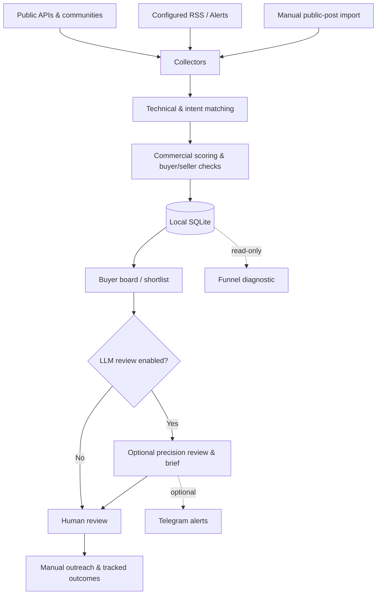

<div align="center">

# IntentScout

**Find the technical problem. Verify the buyer. Decide whether to act.**

A local-first Python system for discovering, evaluating and tracking public requests for **API development, integrations, webhooks and workflow automation**.


[Getting started](#quick-start) · [Architecture](#how-it-works) · [Commands](#command-reference) · [Privacy](#privacy--security) · [Limitations](#limitations)

</div>

---

## Why this exists

Finding technical discussions is easy. Finding someone who **actually wants to hire a developer and may pay for a specific fix** is not.

IntentScout explores public sources, identifies relevant language, applies commercial and suitability filters, and helps a human review the strongest candidates. It is designed to distinguish:

| Signal | Interpretation |
| --- | --- |
| “Need a developer to fix our webhook integration; paid task.” | Potential buyer — verify scope, budget and availability |
| “My API returns a 401; what am I missing?” | Technical question — **not** necessarily a paid opportunity |
| “I build n8n workflows. Available for projects.” | Service provider — **not** a buyer |
| “Hiring locally; onsite work and language requirements apply.” | Hiring intent, but possibly **not eligible** |

**The goal is an actionable shortlist, not a high volume of keyword matches.** Any inferred budget, competition or score remains an estimate until confirmed at the source.

## What it can do

- **Multi-source discovery** — public Hacker News search, GitHub issues, Bluesky public search, selected SaaS communities and configurable RSS/Atom feeds.
- **Buyer-oriented matching** — technical keyword groups, intent aliases, contextual phrases and rule-based scoring.
- **Commercial triage** — separate potential customers from sellers, educational questions and incompatible requirements; maintain P0/P1/P2/reject classifications.
- **Optional LLM review** — classify candidates and prepare concise, evidence-based action briefs, with configurable daily/monthly usage controls.
- **Local tracking** — persist collected records, decisions, feedback and outreach state in SQLite; avoid repeat notifications.
- **Optional Telegram notifications** — notify only when explicitly configured. The tool **does not** automatically message prospective customers.
- **Read-only diagnostics** — inspect the stored source funnel without mutating the database or calling any external model.

## Development history

This repository includes the **actual development commit sequence** rather than a single squashed source snapshot. The main branch retains **18 development commits dated 6–9 October 2026**, followed by public-release preparation and an IntentScout branding commit. Two original alternative commits are preserved in `archive/rss-alternative` and `archive/roi-alternative`.

For privacy, the public history was reconstructed from the original commit graph: personal author emails, private RSS identifiers and operator-specific text were replaced across **every historical commit**. Original dates, subjects and parent relationships are preserved. As a result, historical commit **SHA IDs differ** from those of the local private repository. No personal SQLite database or credentials are included in any public revision.

See [History and privacy](docs/history-and-privacy.md) for verification details and [Publishing safely](docs/publishing-safely.md) before adding a remote.

## How it works



The pipeline has deliberately different layers: *technical relevance* is not the same as *hiring intent*, and hiring intent is not proof of *budget or suitability*.

## Public-source coverage

| Source | Collection approach |
| --- | --- |
| Hacker News | Public HN/Algolia search |
| GitHub | Public issue search; optional token for authenticated API rate limits |
| Bluesky | Public search endpoints |
| Make, n8n | Public Discourse discussions |
| Shopify, Airtable, Zapier, Bubble, Retool, Xano, FlutterFlow | Selected public community endpoints/pages |
| RSS / Google Alerts | Public feed definitions plus **local, untracked** personal feed URLs |
| LinkedIn, Reddit, X, Facebook, Threads, Telegram, Discord | **Manual import of publicly visible post text**; not private-session scraping |

Source reach, freshness and reliability vary. A working collector does **not** guarantee that a source currently contains paid work.

## Quick start

**Requirements:** Python 3.11+; internet access for live collectors. No paid API or Telegram token is required for a basic run.

**Windows PowerShell**

```powershell
py -3.11 -m venv .venv
.\.venv\Scripts\Activate.ps1
python -m pip install -e ".[dev]"
Copy-Item .env.example .env
python -m lead_radar --help
python -m lead_radar once
python -m lead_radar buyer-board --days 3 --limit 20
python -m lead_radar shortlist --limit 20
```

**macOS / Linux**

```bash
python3 -m venv .venv
source .venv/bin/activate
python -m pip install -e '.[dev]'
cp .env.example .env
python -m lead_radar once
python -m lead_radar buyer-board --days 3 --limit 20
```

The first run creates a local SQLite database at `data/radar.db` and requests public sources enabled in `.env`. Depending on network availability, some source requests may fail or return zero matches; review the console output before drawing conclusions.

> **Safe starting configuration:** the supplied `.env.example` disables LLM calls and leaves Telegram credentials empty. Do not enable paid models without reviewing the model ID, pricing settings and usage limits.

### Configuration

Edit your local `.env` (already excluded from Git). Common options:

```dotenv
RADAR_DB=./data/radar.db
HN_ALGOLIA_ENABLED=true
GITHUB_ENABLED=true
MAKE_ENABLED=true
N8N_ENABLED=true
RSS_ENABLED=true
LLM_ENABLED=false
TELEGRAM_BOT_TOKEN=
TELEGRAM_CHAT_ID=
```

Public, non-account-specific keyword and feed definitions are in `config/`. To add a personal Google Alerts feed, use the CLI's `alerts-plan` / `alerts-add` workflow: real feed URLs belong in **`config/feeds.local.yaml`**, never `config/feeds.yaml` or Git. See `config/feeds.local.example.yaml` for the format.

LLM classification is optional. To use it, set `LLM_ENABLED=true`, supply a valid `OPENAI_API_KEY` and model identifier in your **local** `.env`, and verify the budget/pricing fields. Cost controls are application estimates, not a billing guarantee.

## Command reference

| Command | Purpose |
| --- | --- |
| `python -m lead_radar once` | Execute one collection and scoring cycle |
| `python -m lead_radar run` | Poll continuously with configured intervals |
| `python -m lead_radar recent --limit 20` | Inspect stored matches |
| `python -m lead_radar buyer-board --days 3 --limit 20` | Review buyer-like records |
| `python -m lead_radar shortlist --limit 20` | Show prioritized actionable candidates |
| `python -m lead_radar stats` | Local database summary |
| `python -m lead_radar roi --days 30 --by source` | Source-level tracked outcomes |
| `python -m lead_radar optimize --days 30` | Read-only source/query recommendations |
| `python -m lead_radar alerts-plan` | Review suggested Google Alerts queries |
| `python -m lead_radar social-plan` | Preview supported social discovery routes |
| `python -m lead_radar prepare --id 123` | Optional, configured LLM action brief for an existing lead |

CLI options and commands may evolve; `python -m lead_radar --help` is the source of truth.

### Commercial funnel diagnostic

The standalone audit reads an **existing** SQLite database in read-only mode. It reports source activity, stored fresh original topics, reply/comment proportions, buyer-like heuristics and bounded manual-review candidates.

```powershell
python -m lead_radar.funnel_audit --db .\data\radar.db --hours 24 --limit 10
```

For structured output:

```bash
python -m lead_radar.funnel_audit --db ./data/radar.db --hours 24 --format json
```

The diagnostic makes **no outbound network calls, API calls or database writes**. It cannot recover items rejected before being stored, and it cannot verify whether an external buyer is still accepting proposals. See [diagnostic methodology](docs/funnel-diagnostic.md).

## Project layout

```text
intentscout/
├── lead_radar/
│   ├── collectors/       # Public-source adapters
│   ├── app.py            # Orchestration
│   ├── commercial.py     # Buyer/intent filtering
│   ├── matcher.py        # Technical and linguistic matching
│   ├── scoring.py        # Rule-based relevance scores
│   ├── database.py       # SQLite persistence
│   ├── llm.py            # Optional precision gate
│   ├── telegram.py       # Optional notifications
│   └── funnel_audit.py   # Read-only local diagnostics
├── config/               # Public example/query definitions
├── tests/                # Unit and regression tests
├── docs/                 # Methodology and privacy notes
├── scripts/              # Public-release safety check
├── .env.example          # Credentials deliberately blank
└── pyproject.toml
```

## Development and validation

```bash
python -m pip install -e '.[dev]'
ruff check .
mypy lead_radar
python -m pytest -q
python -m compileall -q lead_radar
python scripts/check_public_release.py
```

All tests use synthetic data or mocked external requests; the test suite does not require real customer records, Telegram credentials or LLM calls. GitHub Actions runs linting, typing, tests and the public-release check on pushes and pull requests.

## Privacy & security

The published project must not contain personal lead databases, tracked opportunities, outreach history, raw logs, local contact information, API keys, private Google Alerts RSS URLs, real `.env` files or developer machine paths.

This release is a **fresh, curated source export**, with **no previous Git history**. The file exclusions and `scripts/check_public_release.py` provide defense in depth, not proof that every possible secret is detectable. Before any public push, inspect the exact staged file list and diff; set your Git author email to your GitHub **no-reply address** so commit metadata does not disclose your personal email. Full checklist: [publishing safely](docs/publishing-safely.md).

This repository uses only public interfaces and permitted manual imports; it does not attempt to bypass private login sessions, rate limits or platform access controls. Follow each source's published terms.

## License

No software license is included in this release. Public visibility does not itself grant permission to reuse or redistribute the code. A license can be selected separately.

## Limitations

- **Buyer intent is inferred**, not independently verified. No automatic system can promise an open paid contract.
- **Historical competition counts can become stale.** Check the original thread before reaching out.
- **Funnel diagnostics describe stored items only.** Pre-insertion exclusions are outside their visibility.
- **Coverage is incomplete.** Public endpoints can change or reject requests; not all platforms are searched directly.
- **LLM judgments may be wrong.** The human operator is responsible for qualification, communication and the final decision.
- **No automatic outreach.** The software is a discovery and review assistant, not an email/DM spam bot.

---

<div align="center">

**Built around one principle: fewer unverified leads, more informed decisions.**

*Independent project. Not affiliated with any of the data-source platforms.*

</div>
